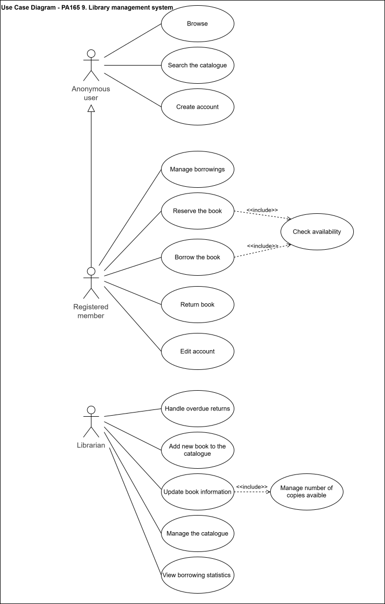
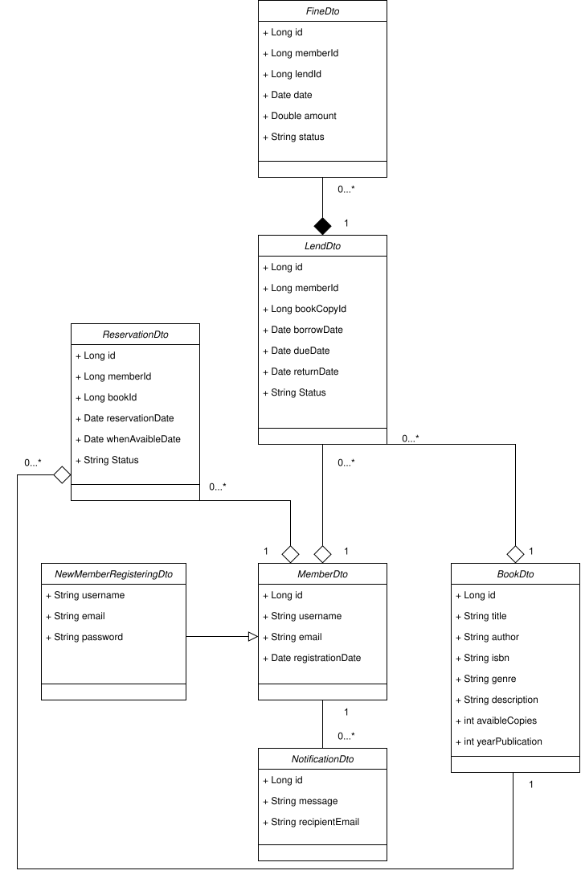

# PA165-project-team3-group02 - Library Management System

## Project description
The goal of this project is to create the information system that enables a virtual library
to manage their resources e.g. books, services. The services are represented by the ability for the
registered members to reserve a book and then borrow it for pre-defined period of time.
It also handles late return fines and provides statistical reports for librarians.

Project is based on the Spring Boot framework.

---

## Team Members
| Name        | Service                             | Role        |
|-------------|-------------------------------------|-------------|
| Member 1    | TODO                                | Developer   |
| Milan Takáč | Lending service                     | Developer   |
| Jakub Valeš | Notification and Statistics Service | Developer   |
| Adam Pap    | Book service                        | Team Leader |

---

## Executable Modules
The project consists of the following independently runnable Spring Boot modules:
TODO...

---

### Build & Run
```bash
# Build all modules
mvn clean install

# Run a specific service (example)
cd book-service
mvn spring-boot:run
```
Then you can see for yourself that the service is up and running by for example entering this URL into your
browser http://localhost:8080/swagger-ui/index.html#/Book/searchBooks
On the URL is based the Swagger-UI with the documentation of the REST API endpoints.

---

## Architecture
The project is equally divided into 4 microservices. Each microservice for one team member.
The microservices in the project are following:
1. Book service
   - managing complete book inventory and catalogue
   - management of the book metadata (titles, authors, ISBN, genres ...)
   - search and browsing API for both anonymous users and registered members
   - managing number of available copies
2. Member service
   - managing member account (username, email, password ...)
   - sign in/ sign up (authentification)
3. Lending service
   - management of the lifecycle of borrowing transactions and reservations for the books
   - enforcing borrowing limits and calculating late return fines
   - tracking borrowing history of the member
4. Notification and Statistics Service
   - borrowing statistics
   - generating reports for librarians on books popularity
   - handling notifications for overdue books
   - informing librarians when specific administrative actions are required

TODO: Who wil do what

---

### Use Case Diagram



**User Roles:**
- **Anonymous User** — can browse and search the catalogue, create an account
- **Registered Member** — can reserve/borrow/return books, manage borrowings, edit account
- **Librarian** — can manage catalogue, handle overdue returns, view statistics

---
## DTO Class Diagram



**Book Service**
- `BookDto` — id, title, author, isbn, genre, description, availableCopies, yearPublication

**Member Service**
- `MemberDto` — id, username, email, registrationDate
- `NewMemberRegisteringDto` — username, email, password

**Lending Service**
- `LoanDto` — id, memberId, bookCopyId, borrowDate, dueDate, returnDate, status
- `ReservationDto` — id, memberId, bookId, reservationDate, whenAvailableDate, status
- `FineDto` — id, memberId, loanId, date, amount, status

**Notification Service**
- `NotificationDto` — id, message, recipientEmail

---

## GenAI Usage
TODO...

